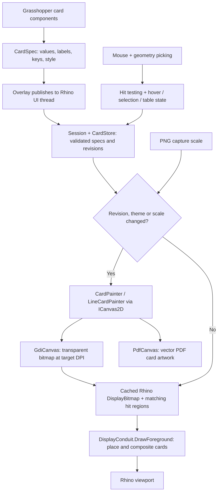
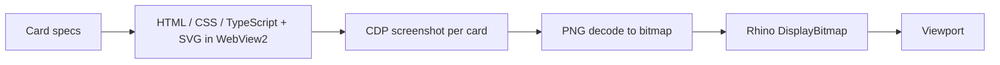

# How a chart reaches the Rhino viewport

The current plugin **still rasterizes** cards. Card artwork is authored in C#,
then painted into transparent bitmaps with GDI+. It does not execute HTML or
JavaScript. The original web prototype did; the difference is who produces the
pixels before Rhino draws the cached texture.

## Current path

`LineComponent` creates a spec; `OverlayComponent` queues it to Rhino's UI thread.
`OverlaySession.Update` applies interaction state and feeds `CardStore`.
`RasterCardRenderer.Prepare` reuses unchanged cards or measures and paints changed
ones. Pixels, spec, revision and hit regions are published together so clicks
refer to what is actually visible. Removed/replaced textures are disposed.

For a line chart, `LineCardPainter` chooses 1/2/5 decade ticks, maps values to
chart coordinates, draws the threshold band, axes, filled line segments and
markers, and leaves gaps for missing values. The painter calls abstract
`ICanvas2D` operations; GDI+ supplies the pixel implementation. There is no chart
library or browser behind these operations.

Ordinary redraws place cached bitmaps through `SlotLayout` and composite them;
they do not rerun a chart layout engine. Hover/click/scroll/sort can change a
card's spec and cause repainting. Hover does not solve Grasshopper; click events
schedule output refresh. Linked geometry is drawn separately as 3D highlights.

PNG captures regenerate bitmaps at DPI × capture scale inside the draw callback;
the next screen draw restores screen scale. PDF uses the same painter through
`PdfCanvas`, producing vector card primitives. Tooltips/drag UI are omitted from
capture. PDF remains experimental; see the [current verification](../verification/capture-pdf.md).

Key source entry points:

- [Components](../../src/ConduitPlus.Grasshopper/Components.cs): card specs and Overlay publishing.
- [CardPainter](../../src/ConduitPlus.Core/CardPainter.cs), [LineCardPainter](../../src/ConduitPlus.Core/LineCardPainter.cs), [ICanvas2D](../../src/ConduitPlus.Core/Drawing.cs): shared artwork and geometry.
- [RasterCardRenderer](../../src/ConduitPlus.Display/Rendering/RasterCardRenderer.cs), [RasterDrawing](../../src/ConduitPlus.Display/Rendering/RasterDrawing.cs), [GdiCanvas](../../src/ConduitPlus.Display/Rendering/GdiCanvas.cs): rasterization and cache.
- [OverlaySession](../../src/ConduitPlus.Display/OverlaySession.cs), [OverlayManager](../../src/ConduitPlus.Display/OverlayManager.cs): session state, input and viewport composition.
- [PdfCommand](../../src/ConduitPlus.Rhino/PdfCommand.cs): vector export branch.

## What happened to HTML/JS?

That pipeline existed. The [renderer spike](../spike/results.md) measured about
155 ms p95 for a metric update and 154 ms for hover, compared with about 3 ms
and 6 ms for GDI+ raster cards in the same hidden Rhino harness. Measurements
include preparation and texture creation, excluding GPU completion and physical
input latency; they are not an interactive orbit benchmark. The standalone
[browser probe](../spike/results-webprobe.md) also found a roughly 90 ms screenshot
floor. Capturing a separate PNG for every hover change was the main problem.

PR #2 / commit `522d006` removed the web/native alternatives and their runtime
plumbing. They remain recoverable at tag `spike-renderer-feasibility`. The spike
actually used fewer physical lines for the web Line card (63 versus 84 for
Raster); it did not demonstrate that hand-authored C# is easier to maintain.
The choice favored measured responsiveness and shared C# integration.

## Keeping the maintainability goal

A second experiment (November 2026, branch since deleted) wrote the same four
cards once in React + Tailwind (TanStack Table headless, D3 for math only) and
measured three pipelines at 2× (p95):

- **Browser:** React updates took < 0.5 ms, but getting pixels out did not:
  `captureScreenshot` ≈ 55 ms, CDP screencast ≈ 18–20 ms in headless Chrome
  (untested in Rhino, and without proof the frame held the requested revision).
- **Satori in .NET** (ClearScript V8 + Svg.Skia, in-process): bar ≈ 29 ms and
  table ≈ 31 ms, against GDI+ 12.6 / 8.1 ms. About half was building and
  re-parsing a 100–135 KB SVG string. Satori's own text metrics also differ
  from GDI+. It adds ~30 MB of V8 and ~12 MB of Skia native code, and allows
  only a flex-only, stateless subset of JSX/CSS.

**Decision: web authoring for viewport cards is dropped; pixels stay in C#.**
The deciding requirement is embedding cards on the Grasshopper canvas as well
as in the viewport. The GH canvas repaints every card on each pan/zoom step, so
any bitmap-producing web path is either blurry or re-renders at 20–30 ms per
card. Replaying `ICanvas2D` vectors into whatever `Graphics` is supplied
(`GdiCanvas` already accepts one) serves the GH canvas, the viewport and
`PdfCanvas` alike. A second opinion (Fable) reached the same conclusion.

Follow-ups for maintainability and speed, staying in C#:

1. Draw hover/selection feedback as a native overlay over the cached card
   instead of repainting the card.
2. Embed cards on the GH canvas by painting `CardPainter` into the canvas `Graphics`.
3. Add declarative layout helpers above `ICanvas2D` so card authors stop repeating
   coordinates and spacing. Keep today's cache, hit testing and shared vector PDF.

Web technology remains fine for real DOM surfaces with no tight latency budget
(an Inspector panel, HTML export, reports), sharing the `CardSpec`/theme contract.
